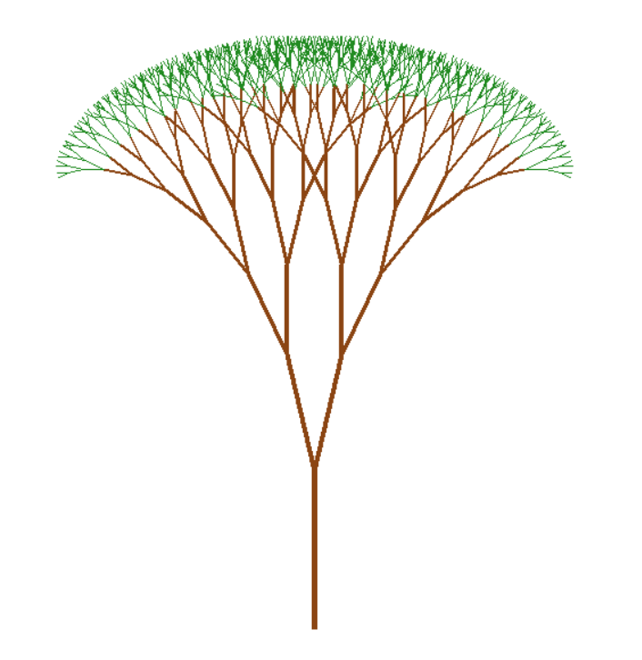

# Космическое небо на Python (pygame)

**Автор:** Готовец Вадим Евгеньевич

**Группа:** ПИ25-1

**Дисциплина:** Практикум по программированию

**Вариант:** 5

**Дата сдачи:**

## Описание проекта

Программа представляет собой фрактальное дерево в 2D

## Запуск:

Версия Python - 3.13 или 3.12

### Для Windows:
```bash
python -m venv venv
source venv/Scripts/activate
pip install -r requirements.txt
python main.py
```

### Для Linux / macOS:
```bash
python3 -m venv venv
source venv/bin/activate
pip install -r requirements.txt
python3 main.py
```

## Должно открыться такое окно:

